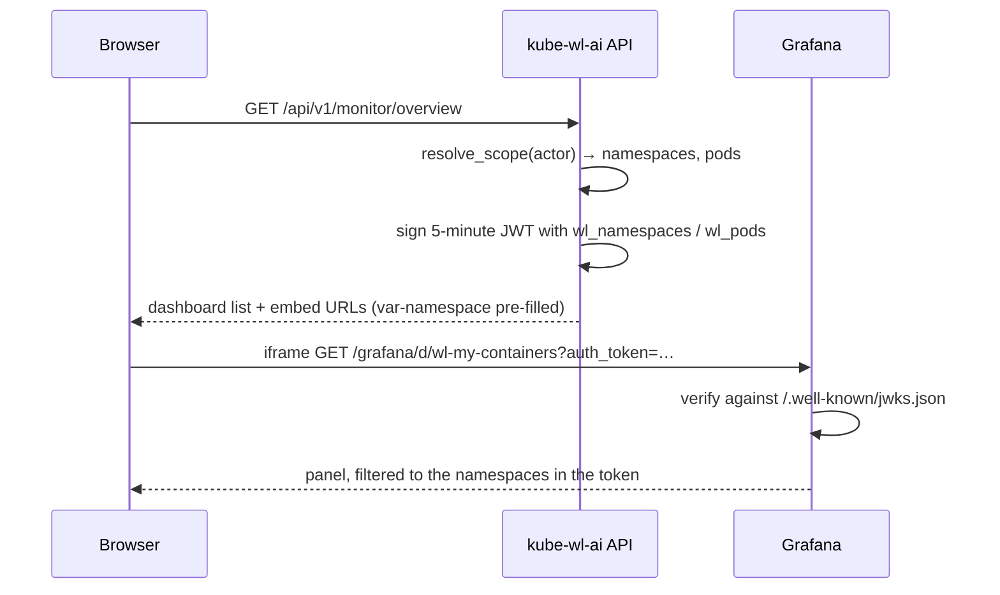

# Grafana integration

The platform **integrates with** the cluster's existing Prometheus and Grafana.
It does not deploy them (plan D6). This directory holds the two things Grafana
needs to serve the monitoring page, and nothing else.

## What is in here

| File | Purpose |
| --- | --- |
| `build_dashboards.py` | Generates the four dashboard JSON files, and refuses to emit one that would leak across tenants |
| `dashboards.yaml` | Provisioning: which folder each dashboard loads into |
| `datasources.yaml` | Provisioning: the Prometheus datasource (`uid: wl-prometheus`) the dashboards read |
| `dashboards/user/*.json` | `wl-my-containers`, `wl-lab-overview` |
| `dashboards/admin/*.json` | `wl-gpu-fleet`, `wl-node-health` |

Regenerate the dashboards after editing the generator:

```bash
python3 deploy/grafana/build_dashboards.py
```

Do not edit the JSON by hand. Grafana's provisioning reloads from disk every
minute and would discard a UI edit anyway.

## How authentication works

Grafana is configured to trust a JWT the backend mints, and **every** user of the
monitoring page arrives through that path. Grafana's own login is not part of the
flow.



Three things make that safe, and none of them is the folder:

1. **The backend never signs a wildcard for a normal user.** The claims hold the
   exact namespaces and pods the caller may watch, from the same data scope the
   REST API uses.
2. **The URL pre-fills those variables and the dashboards require them.**
   `build_dashboards.py` refuses to write a dashboard whose panels are not
   filtered by `$namespace` — and by `$pod` too whenever the dashboard has that
   variable. The pod rule matters: a workspace *is* a namespace shared by a whole
   group, so a "my containers" panel filtered by namespace alone would show a
   user every colleague's containers.
3. **The signed URL lives five minutes** (`GRAFANA_JWT_TTL_SECONDS`). It is a
   bearer credential in a query string, and query strings leak into browser
   history and chat messages. Five minutes bounds the loss to something that only
   ever granted read access the holder already had.

## Required Grafana settings

Set these in Grafana's environment (`GF_*`) or `grafana.ini`.

```ini
[server]
# Serve from a sub-path so the app's nginx can proxy it at /grafana/ and the
# iframe stays same-origin.
root_url = %(protocol)s://%(domain)s:%(http_port)s/grafana/
serve_from_sub_path = true

[auth.jwt]
enabled = true
header_name = Authorization
# The iframe cannot set a header, so the token arrives as a query parameter.
url_login = true
jwt_token_auth = true
username_claim = username
# Grafana caches the JWKS; keep this at or below the token lifetime or a
# rotated key keeps being accepted.
cache_ttl = 5m
# Must be >= the backend's GRAFANA_JWT_TTL_SECONDS, or Grafana rejects a token
# the backend still considers valid.
token_ttl = 5m

[auth]
# Grafana's own login form is never used: every session arrives with a token.
disable_login_form = true
# Anonymous access stays OFF. The dashboards are read-only, but "read-only
# everything for anyone who can reach the port" is not what this system promises.
anonymous_enabled = false

[security]
allow_embedding = true
cookie_samesite = disabled
```

The JWKS URL and issuer must match the backend:

```ini
[auth.jwt]
jwk_set_url = https://<this-app>/api/../.well-known/jwks.json
#   → the backend serves it at /.well-known/jwks.json, outside /api/v1.
expect_claims = {"iss": "kube-wl-ai"}
```

> `.well-known/jwks.json` is served from the app root, **not** under `/api/v1`.
> If the app is published under a path prefix, adjust accordingly.

## Required backend settings

| Variable | Meaning |
| --- | --- |
| `GRAFANA_PUBLIC_URL` | Browser-facing base, e.g. `/grafana`. **Empty disables the whole integration**: the monitoring page still shows the platform's own inventory and says why the panels are missing. |
| `GRAFANA_URL` | Optional internal address, used only for health checks. |
| `GRAFANA_ORG_ID` | Grafana `orgId` echoed into the token. Default `1`. |
| `GRAFANA_JWT_AUDIENCE` | Must equal Grafana's expected audience. Default `grafana`. |
| `GRAFANA_JWT_TTL_SECONDS` | Default `300`. Never exceed Grafana's `token_ttl`. |
| `JWT_PRIVATE_KEY` / `JWT_PUBLIC_KEY` | **RS256 is required.** With the HS256 development fallback `/.well-known/jwks.json` is an empty key set and Grafana cannot verify anything. |

Generate a key pair with:

```bash
openssl genpkey -algorithm RSA -pkeyopt rsa_keygen_bits:2048 -out jwt-private.pem
openssl rsa -in jwt-private.pem -pubout -out jwt-public.pem
```

Only the **public** key needs to reach Grafana, and it reaches it through the
JWKS endpoint. The private key stays with the API.

## Reverse proxy

`frontend/nginx.conf` proxies `/grafana/` to `grafana:3000` through a *variable*
upstream, so the name is resolved per request. An `upstream` block would be
resolved at startup, and a deployment with no Grafana would then fail to start
nginx at all — losing the SPA and the API as well as the panels.

Point it elsewhere by editing the `set $grafana_upstream` line, or skip the proxy
entirely and set `GRAFANA_PUBLIC_URL` to Grafana's own origin.

## Prerequisite: metric labels

The dashboards filter on `namespace` and `pod`. Those labels are present on
metrics from **kube-state-metrics** and **cAdvisor** out of the box, and on
**DCGM exporter** only when it runs as a DaemonSet with `--kubernetes-pod-labels`
or an equivalent relabel rule.

If the cluster's DCGM exporter does not carry `namespace`/`pod`, the GPU panels
show nothing while the CPU and memory panels work. Confirm before go-live:

```bash
curl -s 'http://<prometheus>/api/v1/label/namespace/values'
curl -s --get 'http://<prometheus>/api/v1/query' \
  --data-urlencode 'query=count by (namespace,pod) (DCGM_FI_DEV_GPU_UTIL)'
```

> The platform's own **usage accounting does not depend on any of this.** It is
> computed from the platform's instance and task records (see
> `backend/app/services/usage.py`), so a Prometheus without these labels costs
> you the GPU utilisation *panels* and nothing else.
